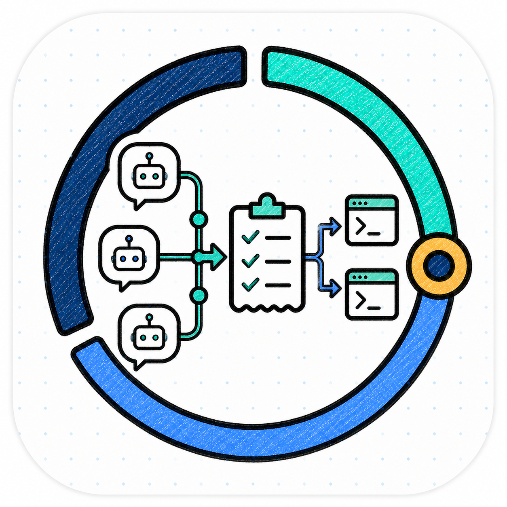
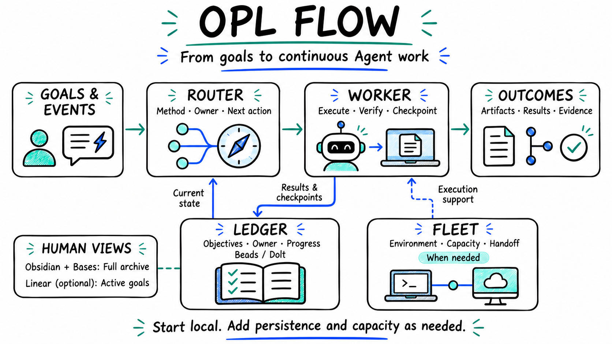

<p align="center">
  
</p>

<p align="center">
  <a href="./README.md">English</a> | <a href="./README.zh-CN.md"><strong>中文</strong></a>
</p>

<h1 align="center">OPL Flow</h1>

<p align="center"><strong>Codex 基线与持久工作协同层</strong></p>

<p align="center">
  
</p>

OPL Flow 为 Codex 提供精简用户 Profile、模型建议、能力策略和可复用 Skill。
可选的 Beads 总账与 Fleet 能力在任务、仓库和机器之间保存工作责任。

Flow 是可选组件。缺少 Flow 不阻断 Codex、OPL Base、App、其他 Package 或领域工作。
推荐能力缺失时，体验状态降级并提供修复入口，Flow 仍可使用。

## 选择工作入口

| 需要完成的工作 | 入口 |
| --- | --- |
| 检查、安装、优化或更新 Codex 基线 | `$opl-flow` |
| 开发、评审、架构优化、文档治理或软件交付 | `$software-development` |
| 协调原生 Codex 任务、集成、恢复或迁移执行负责人 | `$manage-codex-tasks` |
| 保存持久目标并使用可选 Linear 门户 | `$opl-flow start` |
| 准入远端资源并跨机器继续工作 | `$opl-flow fleet` |

插件提供三个路由 Skill，按任务需要加载详细指南；普通小改由模型直接完成。
独立非开发工作流由 [OPL Skills](https://github.com/gaofeng21cn/opl-skills)
维护。第三方能力使用各自的安装与更新渠道。

## 协同模型

OPL Flow 协调四种责任：Router 选择工作方法并找到当前负责人；Worker 自主推进工作、
验证成果，并交回结果或检查点；持续工作由 Ledger 跨执行尝试保存目标、负责人和
进展；需要时由 Fleet 提供环境、容量与接力支持。工作可以从当前本机任务开始，
再随需要增加持久记录或执行资源。

```text
目标/事件 → Router → 当前负责人 / Worker → 成果与证据
              ↑                 |
              └──── Ledger ←────┘（持续工作）
Fleet ── 按需 ──→ Worker 的环境、容量与接力
```

Ledger 是持久任务状态的唯一权威，连接各自 owner 保存的成果和证据。
Obsidian + Bases 提供完整人读档案，Linear 可选地投影活跃目标。更换 Worker、会话或机器后仍继续同一
目标。[工作流架构](docs/reusable-workflow-architecture.md)说明这套协同模型；
自动化交接随真实使用逐步完善，并保留负责人和写集边界。

OPL Flow 白皮书说明一致的任务接收、自动投递和可恢复执行，如何将智能体能力
组织成持续工作的体系：[在线阅读](https://gaofeng21cn.github.io/one-person-lab/latest/whitepapers/opl-flow-whitepaper.html)、
[PDF](https://gaofeng21cn.github.io/one-person-lab/latest/whitepapers/opl-flow-whitepaper.pdf)、
[正文源文件](docs/whitepapers/opl-flow-whitepaper.md)。

## 开始使用

按[新机器安装](docs/new-machine-codex-setup.md)通过当前载体安装，并在新的 Codex
任务中验证发现结果，然后输入：

```text
使用 $opl-flow setup 建立或修复我的 Codex 基线。
```

Setup 部署能力。显式执行 `$opl-flow start` 才创建或复用总账 Dashboard、Bead、
Linear 投影和唯一每小时 `OPL Flow Supervisor`。基础使用不要求 Linear 或 Fleet。

当前模型建议和能力选择由 [workflow-policy.json](contracts/workflow-policy.json)
维护。用户明确选择优先；App 从实时 Codex catalog 解析 Auto 与兼容回退。
Flow 不注入隐藏提示词。

## 职责归属

| 组件 | 职责 |
| --- | --- |
| Codex | 推理、工具、执行和原生任务协调 |
| OPL Flow | Profile 与能力意图、工作方法、总账适配、Git 生命周期和通用 Fleet 引擎 |
| OPL Framework 与原生载体 | Package 生命周期、Profile 物化、能力投影与安装回读 |
| OPL 总账 / Beads | 持久目标、依赖、当前执行负责人、检查点与剩余工作 |
| Obsidian + Bases | 包含动机、成果、剩余工作和证据的完整人读任务档案 |
| Linear | 可选的活跃目标投影，字段范围受限 |
| GitHub 与制品 owner | 当前源码与交付证据 |
| OPL Fleet | 实时节点与 workspace 准入、容量租约和执行连续性 |
| 私人 OPL Instance | 私人总账、拓扑、策略、运营记录和个人配置 |

Fleet workspace 与 owner migration 合同已有源码实现；具体节点、迁移或已安装
Package 仍须独立回读。[Fleet 架构](docs/opl-fleet-architecture.md)明确区分了
已有实现与更广泛的设计工作。

凭据、会话、对话内容、日志、缓存、私人路径和租约密钥不进入公开包，也不作为
节点间同步内容。

[人读档案与活跃投影](skills/opl-flow/references/ledger-human-archive.md)保留可读的
完成历史，无需为每次会话或每条历史 Bead 保留 Linear 卡片。档案回读和平台实际
额度分别验收。

## 开发

```bash
scripts/verify.sh
scripts/verify.sh full
```

这些检查验证源码合同，不安装、不发布，也不证明用户机器生效。
[文档索引](docs/README.md)分别指向架构、安装、协议和维护指南。

## 许可证

[Apache-2.0](LICENSE)。第三方方法来源与许可证见
[THIRD_PARTY_NOTICES.md](THIRD_PARTY_NOTICES.md)。
