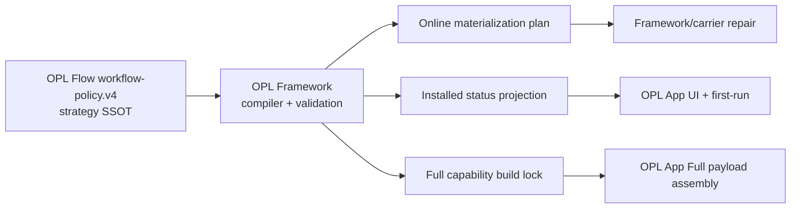

# OPL Flow Capability Governance

Owner: `OPL Flow`
Purpose: `capability_composition_architecture`
State: `active_source_architecture_ssot`
Machine boundary: `contracts/workflow-policy.json`, current source/tests, and
fresh Framework/carrier/executor readback own policy bytes, projections,
installed state, callability, publication, and release qualification.

## Decision

OPL Flow is the sole strategy owner for the default Codex working experience.
The policy covers:

- the user Profile and three-router development payload;
- recommended model and reasoning intent;
- default Skills and Tools, their source owners, installation intent, and
  degradation behavior;
- optional external capability discovery;
- online repair and Full/offline selection intent;
- readiness adapters and capability bundles.

Framework is the generic compiler and runtime owner for that strategy. It
validates the Flow policy, compiles materialization/status/build-lock
projections, invokes owner-supported adapters, installs or repairs selected
capabilities, and reads back effective state.

OPL App is a consumer. It renders Framework status, starts generic Framework
actions, and materializes a pinned Full build lock. It does not parse
`workflow-policy.json`, choose the default capability set, or maintain a second
recommended-Skill catalog.

Development methods, lenses, and specialists are internal Package references,
not another recommendation catalog or a set of independently discoverable
Skills. `software-development` loads one focused group only after the task
matches; `manage-codex-tasks` does the same for coordination and recovery.

This is the lowest-cognition architecture because a default capability change
has one authoring location and only generated consumers:



No reverse edge may make App or Framework policy the semantic owner.

## Authority Map

| Surface | Owner | Consumer boundary |
| --- | --- | --- |
| Default capability identity, grouping, source, criticality, install intent, distribution intent, and degradation semantics | OPL Flow | Framework compiles; App never duplicates |
| Core Flow Plugin/Profile/Skills payload | OPL Flow | Framework/carrier installs and reads back |
| Generic policy parser, compiler, materializer, repair, status, and build lock | OPL Framework | Must remain data-driven and reject unknown policy fields |
| Owner-specific repair adapter | Capability owner, invoked by Framework | Example: `agent-reach skill --install` |
| App Auto model resolution, UI, persistence, explicit user choice, and fallback | OPL App | Installed Flow recommendation is an input, not App-owned policy |
| Standard/Full product assembly and release evidence | OPL App | Full consumes a Framework-generated lock; it does not select capabilities |
| Effective `AGENTS.md` and explicit settings | User | Flow proposes safe merge; user overrides win |
| Non-development reusable or domain workflows | OPL Skills or domain package | Explicit user-level installation |
| Private Ledger/Fleet topology and state | OPL Instance | Public Flow supplies reusable engines only |

## Policy Model

`contracts/workflow-policy.json` uses `opl_flow_workflow_policy.v4` and separates
five concerns:

1. `provides`: the Plugin and exactly three Flow-owned router Skills.
2. `requires`: dependencies whose absence can make Flow itself non-operational.
3. `experience_baseline`: default/recommended capabilities. Absence degrades
   the experience but never disables Flow, Ledger, or core Skills.
4. `compatible_optional`: discoverable enhancements with no default install or
   repair obligation.
5. `capability_bundles`: user-meaningful groups whose members still retain
   independent source, lifecycle, readiness, and distribution metadata.

The three status planes are intentionally independent:

- `package_operational`: Flow is installed and callable, including `requires`.
- `experience_baseline`: default capabilities are current or `degraded`.
- `specialized_capabilities`: optional enhancements are present or absent.

`experience_baseline=degraded` must not be translated into
`package_operational=unavailable`.

## Bundle And Tier Governance

The `capability_bundles`, `experience_baseline`, and `compatible_optional`
fields in [workflow-policy.json](../contracts/workflow-policy.json) own current
membership, install intent, distribution selection, and readiness adapters.
This document does not maintain a duplicate capability inventory.

- **External owners and readiness:** External baseline tools and Skills keep
  their upstream source, installer, and update channels. Framework checks
  declared payload/CLI readiness and invokes owner-supported repair adapters
  when managed; missing baseline capabilities degrade `experience_baseline`
  without disabling Flow, Ledger, or core Skills. Credentials and authenticated
  channels remain user/provider owned and are never bundled.
- **Optional enhancements:** `compatible_optional` entries carry no default
  install, offline payload, or repair obligation; their absence is normal.
- **Full selection:** `offline_bundle=full` is the only Flow-owned Full
  selection signal. App source manifests may provide version or repository hints
  for a selected adapter, but they cannot add items to the policy-derived plan.
- **Three-router discovery boundary:** All OPL-owned software-development
  capability shares one Plugin lifecycle with discovery strictly limited to
  `opl-flow`, `software-development`, and `manage-codex-tasks`; internal
  methods remain unaliased references under those routers. Non-development
  reusable workflows remain separate in [OPL Skills](https://github.com/gaofeng21cn/opl-skills).

## Model And Profile

Flow recommends `gpt-6.2-astra` with `max` reasoning. The precedence is:

```text
explicit user selection
> installed Flow recommendation
> fresh Codex model catalog/default
> App fallback when Flow is unavailable
```

App owns Auto resolution, visible controls, persistence, and fallback. Flow
owns the recommendation only; it cannot claim an unavailable model is usable.

Profile mutation preserves user ownership through backup, semantic merge,
target-hash stale-write protection, validation, atomic replace, and readback.
Flow never injects a hidden base prompt.

## Install, Setup, And Start

Package installation, update, and `$opl-flow setup` deploy or repair
capabilities only; only explicit `$opl-flow start` creates or reuses the Ledger
Dashboard, Bead, Linear projection, and `OPL Flow Supervisor`. See
[machine setup](new-machine-codex-setup.md) for operator commands.

## Executor Compatibility

The production route is Codex-first: Codex Plugin Manager is the native
Plugin/config/cache carrier and Codex CLI supplies execution, while Framework
owns OPL Package installation and reconciliation across that carrier.

Flow's Package identity, Profile intent, public status, and public actions do
not embed Codex-private session fields. Neutral-contract tests establish that
boundary; they do not certify a second executor or carrier. No parallel Claude
or other external executor product is supported here; a future executor
requires an explicit product decision and a real adapter with its own readback.

Flow is optional. Removing it must leave Base, App, ordinary Codex, other
Packages, and domain work usable, and Flow never injects hidden base prompts
or overrides repository instructions and explicit user preferences. Changing an
executor preserves the stable Package identity and user-owned Profile,
preferences, and tasks; a missing executor adapter is a route-specific failure,
not disappearance of the Package or user data. Standard and Full consume the
same Flow policy through Framework, while assembly and release qualification
remain App-owned.

## Carrier And App Profile

Framework resolves ordinary Package publication from the owner's per-Package
`latest-stable` channel and uses the configured native carrier for installation.
The shared manifest and Full build lock bind release or offline evidence; they
are not a second ordinary Package currentness authority.

Standard and Full use one App Official Profile. Profile ensure runs at first
install or explicit Restore. User removal persists across restart, update, and
maintenance; background maintenance updates only installed Packages. App reads
Framework's aggregate state, never a Plugin listing alone. Credentials, OAuth,
account data, and unknown third-party MCP configuration are not bundled or
overwritten.

## Framework Projection Contract

Framework emits generic, machine-readable surfaces:

- `opl_flow_capability_strategy_projection.v1`: policy identity, bundle state,
  online materialization plan, Full distribution plan, and health adapters;
- package status at
  `app_state.agent_packages.status_index.packages.opl-flow.capability_strategy`;
- `system_initialize.recommended_skills`, derived from the installed strategy;
- `opl_flow_capability_build_lock.v1`, binding one Full strategy digest to the
  resolved source ref, version, and SHA-256 of every selected payload.

Managed mode may invoke owner-supported install/repair adapters. Observe mode
must not write. If no installed Flow-derived plan exists, companion
materialization is a true `0/0` no-op rather than a fallback static catalog.

App Full assembly accepts only adapters it implements, materializes exactly the
build-lock items, and fails closed on unknown, missing, duplicate, drifted, or
unselected payloads. The runtime receipt records the pre-materialization source
hash and the packaged payload hash after native trust processing.

## Change Process

To add, remove, or change a default capability:

1. edit the Flow policy and schema/tests;
2. compile it with Framework and inspect online, status, and Full projections;
3. add a generic Framework adapter only when the capability kind or owner
   protocol is genuinely new;
4. update an App adapter only when a newly selected Full payload needs product
   assembly support;
5. verify Flow-only, degraded baseline, online repair, Full build-lock, and App
   consumer paths;
6. read back canonical source and, when authorized separately, installed or
   published state.

Do not patch an App `recommended_skills` list or restore a Framework static
catalog. Those are symptoms of authority duplication.

## Terminal Boundary

Source, tests, task branches, build locks, and dry runs prove implementation
only. They do not prove publication, installation, App release, or effective
machine state. Each terminal claim requires the corresponding owner readback.
